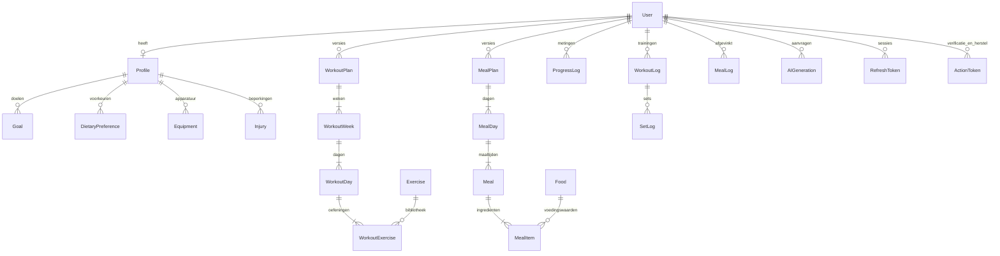

# Datamodel

Profielvelden staan in `Profile.data`, gevalideerd door het gedeelde Zod-schema. De uitbreidbare Goal/Equipment/Injury/DietaryPreference-relaties zijn voorbereid voor toekomstige filters; de huidige intake leest en schrijft de JSON als bron. AI-generaties worden zowel als gevalideerde JSON-versie als relationele trainings- en voedingsplannen opgeslagen. Gebruikersgegevens hebben cascade-delete. Unieke combinaties voorkomen dubbele versies, maaltijdlogs en sets.
